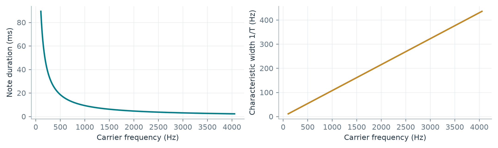
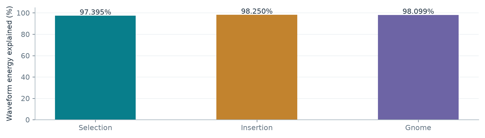
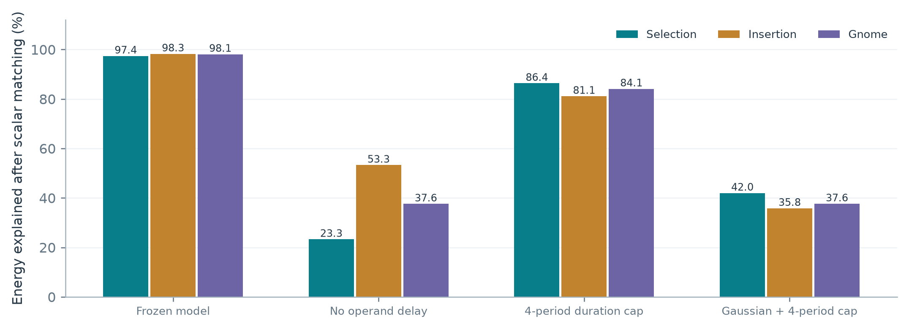
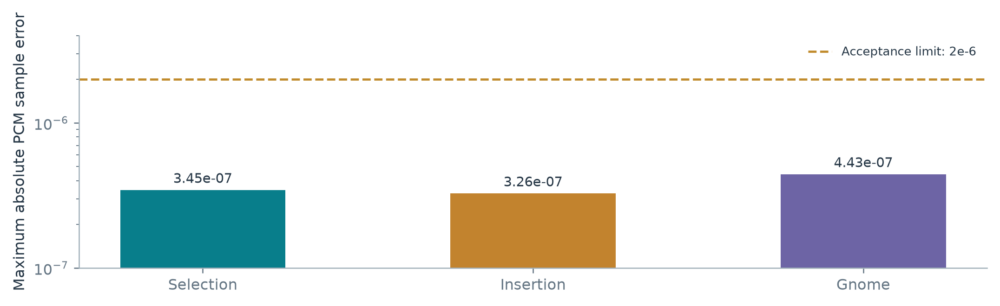

ACTUALLY GOOD SORTING SOUNDS  /  RESEARCH PAPER 01

# Reconstructing Andrut's Sorting Sonification

A delayed sine-burst model, its mathematical explanation,<br/>and validation across three sorting algorithms

17 October 2026  |  Version 1.0<br/>Evidence and implementation through 16 October 2026


## Abstract

Andrut's sorting demonstration combines moving pitches with a persistent 300 Hz harmonic family and conspicuous spectral cancellation regions. Those observations initially suggested a harmonic oscillator bank, chorus, or a filtered sawtooth. A known 100-item input permutation made a more discriminating reconstruction possible: reproduce the exact comparisons, then identify the sound produced by their ordered operands.

The resulting effective model launches phase-reset sine bursts on a 300 Hz clock. Each burst lasts a fixed number of carrier cycles, captures its pitch at birth, and overlaps earlier notes. The two operands have equal gain and a relative onset offset of approximately 225.67 microseconds. One common calibrated 31-tap FIR processes their sum. The model requires no independent humming bed or chorus.

Parameters and the FIR were fitted on Selection Sort. With that common source, filter, and gain, saved validation results explain 97.395% of Selection's waveform energy, 98.250% of Insertion's, and 98.099% of Gnome's. A subsequent C++ implementation agrees with the frozen Python synthesis to a maximum float32 sample error below 4.5 x 10<super>-7</super>. These are separate claims: agreement with the recordings supports the reconstruction; agreement between implementations verifies the port.


> **Scope of the claim** This paper describes an evidence-supported reconstruction of Andrut's observable audio behavior. The creator's source code is unavailable to this study. Numerical agreement does not uniquely identify the original implementation, analog circuit, filter design, or intended parameter values.

Prepared for the Actually Good Sorting Sounds project from user-supplied reference media, saved research artifacts, and existing validation records. No new audio experiments, model fitting, or test-suite executions were performed for this paper. New explanatory plots evaluate the documented equations; empirical plots and numerical scores reuse saved artifacts.

<b>Reading guide.</b> Source and spectral theory: pp. 3-7. Identification and recording evidence: pp. 8-12. C++ parity and runtime: pp. 13-15. Configuration and interpretation: pp. 16-17. Exact constants and provenance: pp. 18-20. Section bookmarks are included in the PDF.


# Evidence and the recovered input

The primary dataset consists of three supplied mono float32 WAV recordings at 44,100 samples/s and a 1,218 x 720 raster image of the initial bars. The image provides 100 distinct height ranks; it does not reveal the source program's original numerical magnitudes. Ranking the recovered heights therefore preserves the order and equal spacing without pretending that pixels are the original data. [R1-R3]

| Recording | Source frames | File duration | Role in identification |
| --- | --- | --- | --- |
| Selection | 733,500 | 16.6327 s | Source and common FIR fitting |
| Insertion | 416,388 | 9.4420 s | Cross-algorithm validation |
| Gnome | 819,556 | 18.5840 s | Cross-algorithm validation |


The visible order begins [78, 89, 75, 81, 31, ...]. The alternative allowed first pair is [89, 78, ...]. The array contains 2,724 inversions. The reconstruction retains this temporal uncertainty even though the raster heights themselves have no ties. Earlier 80-bar estimates in the research history are superseded for these three recordings.

| Schedule | Comparisons | Active duration at 300/s | Effective early / late operand |
| --- | --- | --- | --- |
| Selection | 4,950 | 16.500000 s | Current minimum / scanned item |
| Insertion | 2,818 | 9.393333 s | array[j] / held key |
| Gnome | 5,542 | 18.473333 s | array[i] / array[i-1] |

Recording durations include scene boundaries and cuts. They need not equal comparison-count duration. Exactly 147 source samples per comparison at 44.1 kHz supplies the common 300 Hz timing grid. Operand order is an effective audio-timing identification; it is not proof of the creator's comparator syntax.


# The reconstructed instrument


> **Signal path** Ordered comparison operands -> normalized values -> two captured-pitch sine-burst lanes -> relative operand delay -> direct overlap sum -> common calibrated FIR -> output. The experimental application adds optional controls and device conversion after this reference path.

| Quantity | Frozen value | Meaning |
| --- | --- | --- |
| Internal sample rate | 44,100 Hz | Reference discrete-time clock |
| Excitation / comparison clock | 300 Hz | 147 samples between comparison ticks |
| Minimum carrier pitch | 104.0322699094767 Hz | Rank 0 in the recovered input |
| Pitch step for 100 ranks | 39.90533652820316 Hz | Continuous linear mapping |
| Maximum carrier pitch | 4,054.6605862015895 Hz | Rank 99 |
| Carrier cycles per note | 9.302650315454065 | Duration C/f; no clock-period cap |
| Tukey taper fraction | 0.025666772580559438 | Short cosine edges and flat interior |
| Relative operand delay | 9.95199933051814 samples | 225.668919 microseconds |
| Carrier phase at birth | 0 radians | Each note restarts its own sine |
| Operand gains | Equal; 0 dB role offsets | Natural overlap; no active-note normalization |
| Common output response | 31 causal FIR coefficients | Includes the fitted reference gain |
| Independent bed / chorus | None / off | Periodic overlap produces the hum |

For this input, rank r maps to f<sub>r</sub> = f<sub>0</sub> + s r. The application generalizes this to normalized input values using the prepared array's fixed extrema. Sorting and rearrangement never change an item's assigned pitch. Equal-value arrays map to the pitch-range midpoint. [R3, R4, R7]


$$
u(v)=\frac{v-v_{\min}}{v_{\max}-v_{\min}},\qquad f(v)=f_{\min}+(f_{\max}-f_{\min})u(v)
$$

(1)

The many decimal places preserve a numerical fit and deterministic rerendering. They do not establish that Andrut deliberately chose those exact physical settings. A useful verbal recipe is approximately 100-4,060 Hz, nine-cycle sine notes, 300 comparison ticks/s, short cosine edges, and a ten-sample operand offset.


# Finite notes, phase, and overlap

Let F<sub>s</sub> be the sample rate, C the carrier-cycle count, alpha the taper fraction, and f the captured carrier frequency. The reference rounds duration to the nearest integer sample with ties to even. This detail, the endpoint convention, and fractional delay matter when comparing individual PCM samples. [R3, R5, R7]


$$
L_f=\max\left(2,\operatorname{roundEven}\left(\frac{CF_s}{f}\right)\right),\quad x_q=\frac{q}{L_f-1}
$$

(2)


$$
h_f[q]=w_\alpha(x_q)\sin\left(\frac{2\pi f q}{F_s}\right),\qquad 0\leq q<L_f
$$

(3)

For 0 &lt; alpha &lt;= 1, the Tukey window is defined by the following three intervals. Outside the note support, h is exactly zero. At the fitted positive taper, both window endpoints are zero.

| Normalized age x | Window amplitude |
| --- | --- |
| 0 &lt;= x &lt; alpha/2 | [1 - cos(2 pi x / alpha)] / 2 |
| alpha/2 &lt;= x &lt;= 1 - alpha/2 | 1 |
| 1 - alpha/2 &lt; x &lt;= 1 | [1 - cos(2 pi (1 - x) / alpha)] / 2 |


Every comparison births a new note for each operand. Its frequency, gain, taper, and duration stay captured until that note ends. Older notes continue while later comparisons change. The overlap sum therefore contains a history of recent comparisons, even though event handling never waits behind an audio queue.


$$
s[n]=\sum_k\sum_{a=1}^{2}g_{ka}\,\widetilde h_{f_{ka}}[n-n_k-m_a],\qquad n_k=\left\lfloor\frac{kF_s}{F_c}\right\rfloor
$$

(4)

Here m<sub>a</sub> is the integer part of the lane's relative onset, and the tilde includes its fractional-sample interpolation. At the reference rate n<sub>k</sub> = 147k. All active terms sum directly, with no division by the number of sounding notes.

This separates two notions often conflated in early experiments: the 300 Hz clock determines when notes are born; the value-controlled carrier determines what each finite note contains. A birth clock is not an oscillator pitch grid.


# Why a sine source produces 300 Hz lines

Consider a value held fixed while its finite note h<sub>f</sub>(t) is launched every P = 1/F<sub>c</sub> seconds. Away from the beginning and end of the run, the sum is periodic. Its Fourier-series coefficients sample the continuous note spectrum H<sub>f</sub> at multiples of the launch clock.


$$
s_f(t)=\sum_{k\in\mathbb{Z}}h_f(t-kP),\qquad c_m=F_c H_f(mF_c)
$$

(5)


$$
S_f(\nu)=F_c\sum_{m\in\mathbb{Z}}H_f(mF_c)\,\delta(\nu-mF_c)
$$

(6)

Multiplying a sine by a finite time window shifts that window's transform to the positive and negative carrier frequencies. Its envelope remains centered near a continuous value-controlled pitch, while periodic repetition samples that envelope on the 300 Hz family.


$$
H_f(\nu)=\frac{W_T(\nu-f)-W_T(\nu+f)}{2j}
$$

(7)


Changing operand values disrupt exact periodicity and adds transient and inter-harmonic structure. Thus a moving diagonal ridge and a fixed 300 Hz line family can coexist. Strictly stationary, infinitely repeated notes have only clock harmonics; a low carrier does not imply a separate persistent oscillator at that exact off-grid frequency.

This explains why the original fixed-bin interpretation was too restrictive. A bank could mimic some spectra, but the observed line spacing alone never selected a bank or a sawtooth. Repeated sine notes provide another mechanism and, with the known schedules, transfer much more accurately across the saved recordings.


# The widening focus and apparent energy trade

A fixed cycle count makes note duration inversely proportional to carrier pitch. The characteristic spectral width of a time-limited note is proportional to the inverse of its duration. Higher selections therefore spread across a broader frequency interval without requiring a value-dependent tau control or a separately moving Gaussian filter.


$$
T(f)=\frac{C}{f},\qquad \Delta\nu\sim\frac{1}{T}=\frac{f}{C},\qquad F_cT=\frac{F_cC}{f}
$$

(8)




The same relation predicts roughly 26.83 clock periods of overlap for a repeated minimum-pitch note, versus 0.69 periods at the maximum. The previous four-period packet cap allowed only 13.33 ms and removed much of the low-pitch history. That was a structural change, not merely a gentler envelope setting.

At fixed peak amplitude, an isolated note's energy generally falls as its duration shrinks. Ignoring the finite-carrier cross term, the squared integral of a Tukey window gives the following approximation:


$$
E_h(f)\approx\frac{A^2T(f)}{2}\left(1-\frac{5\alpha}{8}\right)\propto\frac{1}{f}
$$

(9)

The complete signal is a coherent sum, so cross terms between overlapping notes can reinforce or cancel. Total output energy is not the sum of isolated-note energies. No automatic conservation rule, Gaussian energy budget, or active-note gain normalization is needed by the fitted model.

The earlier ordered-sweep analysis independently recorded strongly varying local RMS: its first interval had 5th/50th/95th percentiles 0.0156/0.0451/0.1332, and the later scan 0.0125/0.0418/0.1862. Those saved observations do not establish constant energy. They also do not identify different generators for the two sweep regions. Their exact operand schedules were not recovered. [R10]


# The apparent comb and the shared response

For two identical signals separated by delta seconds, their sum has an interference response 1 + exp(-j 2 pi nu delta). After dividing by its DC gain, the ideal magnitude and cancellation frequencies are:


$$
\frac{|1+e^{-j2\pi\nu\delta}|}{2}=|\cos(\pi\nu\delta)|,\qquad \nu_k=\frac{2k+1}{2\delta}
$$

(10)

The fitted delay predicts minima near 2,216, 6,647, 11,078, and 15,509 Hz. These track the muted regions noticed in the spectrograms. Exact cancellation requires matching signals and coherent timing. Different operand values can fill the minima; the discrete interpolation used by the reconstruction also makes the ideal zero-depth prediction approximate.


$$
y[n]=\sum_{\ell=0}^{30} b[\ell]\,s[n-\ell]
$$

(11)

The coefficients are an effective common response learned from Selection, not an identified original analog filter. It can absorb source coloration, recording response, and other unresolved linear effects. The coefficients are not symmetric: the saved 15-frame alignment convention must not be described as a proven constant group delay.

A forum comment suggested a toothy source and a possible band-reject filter while explicitly expressing uncertainty. That historical suggestion motivated useful hypotheses, but it is not evidence of Andrut's implementation. Timo Bingmann's separate Sound of Sorting program documents a triangular, enveloped source; its implementation should not be attributed to Andrut. [R11]


# Identification and alignment methodology

Knowing the array allows each deterministic algorithm to regenerate ordered operand sequences before fitting any audio. That removes a major ambiguity: otherwise a poor match could come from the wrong comparison history rather than the wrong synthesizer. The source controls are theta = (base pitch, rank step, cycles, taper, operand delay). [R4, R5]


## A compact nonlinear source and a linear output fit

The saved refinement script searches the compact source controls on Selection with seeded differential evolution. For each candidate, a 31-column shifted-source matrix B is compared with aligned reference samples. A small ridge term stabilizes the common FIR least-squares estimate. Candidate evaluations use up to 20,000 selected frames; the final response is fitted using up to 80,000. These are fitting-sample counts, not independent recordings.


$$
\widehat{\mathbf{b}}=(B^TB+\lambda I)^{-1}B^T\mathbf{x},\qquad \lambda=10^{-8}\frac{\operatorname{tr}(B^TB)}{31}
$$

(12)

Source parameters and output FIR are then frozen. Insertion and Gnome reuse them without a new source, filter, or primary output gain. Recording offsets and effective operand order are identified for each clip. This is cross-algorithm transfer, not a preregistered blind experiment: the research process inspected these recordings while developing hypotheses.

| Clip | Late-operand offset in source file | Pack waveform alignment offset |
| --- | --- | --- |
| Selection | 6,463 samples | 6,416 samples |
| Insertion | 959 samples | 912 samples |
| Gnome | 5,532 samples | 5,485 samples |

The pack adds 32 preroll frames and uses a 15-frame FIR alignment convention: offset<sub>pack</sub> = offset<sub>late</sub> - 47. The first lane is earlier by the fitted 9.952 samples. The C++ scheduling lead is a different implementation offset and is treated separately in Section 11.


## Primary scoring interval

The scoring script omits the first and last 5,000 synthesis frames (about 113.38 ms at each edge), clips to available reference data, and compares the aligned body. This suppresses previous-scene sound and cut-boundary effects. It does not claim that excluded transients are matched, nor that the residual within the scored region is purely encoding noise.


# Agreement with the supplied recordings

The primary score is an uncentered relative squared-error measure. Its denominator is reference energy, not mean-subtracted variance. Pearson correlation separately measures mean-centered waveform correlation. Neither quantity is a percentage of perceptual identity.


$$
Q_E=1-\frac{\sum_n(x[n]-y[n])^2}{\sum_n x[n]^2},\qquad \rho=\frac{\langle x-\bar{x},y-\bar{y}\rangle}{\|x-\bar{x}\|\,\|y-\bar{y}\|}
$$

(13)

| Algorithm | Scored frames | Correlation | Energy explained | Residual RMS |
| --- | --- | --- | --- | --- |
| Selection | 717,650 | 0.98703 | 97.395% | 0.012516 |
| Insertion | 404,246 | 0.99140 | 98.250% | 0.011833 |
| Gnome | 804,674 | 0.99066 | 98.099% | 0.010278 |




Selection is the fitting recording, so its score is not an independent prediction. Insertion and Gnome support transfer of the source mechanism. Their primary scores use the common FIR gain. The optional best scalar gains in the saved diagnostics are approximately 0.99991, 1.01175, and 1.01211; those corrections were not applied to the primary scores or exported reconstruction audio. [R2]

The full Python reconstructions peak at approximately 0.59772, 0.63155, and 0.61480. The nine exported WAV files were previously read back and checked. Six purely synthesized files were also regenerated in a separate process with the reference directory intentionally unavailable; their hashes matched. This demonstrates that synthesis uses the profile and event sequence rather than replaying the reference samples.

The remaining 1.75-2.60% error energy has not been uniquely attributed. It may include residual source-model mismatch, alignment details, recording processing, and encoding effects. A high score does not license assigning all remaining error to any one of those causes.


# Spectral agreement across complete runs


The correspondence is algorithm-dependent: persistent operands, moving operands, and different revisit patterns generate distinct structures. Matching those structures with the same instrument is stronger evidence than matching a generic ordered sweep. The plot still cannot prove a unique generator: it displays magnitude and loses phase information.

A 2,048-sample analysis window spans about 46.44 ms and has bin spacing about 21.53 Hz. Window smoothing broadens narrow features; zero padding, if used for another display, only densifies frequency samples. Neither a spectrogram's bright ridge nor a visual upper edge directly measures a source oscillator endpoint.


> **How to read the image** Repeated lines reveal periodic structure; moving intensity reveals changing packet spectra and interference. These are compatible observations. Treating every bright line as a separately synthesized oscillator discards the event timing that makes the reconstruction work.


# Waveform phase and mechanism ablations


| Saved model modification | Selection | Insertion | Gnome |
| --- | --- | --- | --- |
| Frozen model | 97.40% | 98.26% | 98.11% |
| Remove operand offset | 23.29% | 53.28% | 37.60% |
| Cap notes at four clock periods | 86.37% | 81.12% | 84.11% |
| Gaussian window + four-period cap | 41.99% | 35.82% | 37.64% |

These ablation scores allow one best scalar gain for every variant, including the full model, while retaining the frozen output-filter shape. That concession prevents a quieter variant from losing solely on level. It does not re-optimize source controls or learn a replacement filter. The large no-delay collapse supports the importance of operand timing within this model family. The duration cap is also materially harmful.

The combined Gaussian-plus-cap condition changes two factors; it does not isolate the window's independent causal effect. More generally, these controls reject these specific substitutions under the frozen response. They do not prove that every alternative model with a separately optimized response must fail.


# What remains uncertain in the reconstruction





## The first two array elements

Selection's fixed-gain score falls from 97.395% to 95.747% when the first pair is reversed. That favors the visible order within this reconstruction. Insertion's later state becomes the same after its first insertion, so the scored body is unchanged. Gnome's extra initial comparison is absorbed by a one-event alignment shift. Those two clips cannot independently resolve the initial-pair uncertainty.


## Source and filter are jointly identifiable only in an effective sense

The source controls and short FIR can trade some spectral details. A finite collection of output recordings cannot determine the creator's intent, hidden processing order, exact numeric representation, or whether an equivalent signal was produced offline. Replacing the compact source with a sufficiently flexible system could recreate the same PCM by other means. The preferred model is useful because it is compact, reproducible, interpretable, and transfers across schedules.


## A 4.2 kHz ridge is not the fitted endpoint

The saved fit ends at 4,054.66 Hz for rank 99. Finite-note spectral width, operand interference, the output response, and the STFT can place visible energy above that carrier. The earlier 4.2 kHz ceiling was a practical exploratory constraint rather than a final measured oscillator setting. Upper spectral shoulders likewise do not require 17.1 kHz carrier bins.

The data support delayed sine bursts as a successful reconstruction of these three recordings. They do not establish universality across all Andrut demonstrations, exact behavior on duplicate/constant arrays in the original program, or whether the original source used the same numerical constants.


# Independent C++ implementation agreement

The application uses a C++14 implementation of the frozen burst model. Its x64 Release exporter produced the saved ordered comparison fixtures and raw float32 output. The parity tool first checks normalized operand pairs, including Gnome's declared reversal, then compares C++ PCM against Python synthesis from the frozen profile. It does not read the reference recordings or fit another response. [R6, R7]

| Algorithm | Aligned frames | Max abs. error | RMS error |
| --- | --- | --- | --- |
| Selection | 731,656 | 3.44784e-07 | 6.05716e-08 |
| Insertion | 418,252 | 3.26363e-07 | 5.20083e-08 |
| Gnome | 818,680 | 4.42972e-07 | 4.99454e-08 |




The only shift is the documented relative scheduling offset: 128 C++ lead frames minus 32 Python preroll frames = 96 samples, or approximately 2.177 ms. No optimized gain, filter, or recording-specific time shift is introduced. Maximum normalized-operand error is 2.95013 x 10<super>-8</super>, consistent with the float representation of normalized rank values.

C++ uses double precision for captured note evaluation and mixing, with float32 device/export samples. Duration rounding matches Python ties-to-even. The Tukey coordinate uses age/(length - 1). A fractional delay d = m + beta is represented by a weighted current/previous sample pair, equivalent to z<super>-m</super>[(1 - beta) + beta z<super>-1</super>] for nonnegative causal placement. The Python fixture expresses the first operand as a negative relative offset; the app supplies causal scheduling lead.


$$
\widetilde h[q]=(1-\beta)h[q]+\beta h[q-1],\qquad 0\leq\beta<1
$$

(14)

The saved pack has three complete reference rerenders plus 22 listening scenario groups. Excerpting longer runs produces 55 raw/listening clip pairs. Its maximum raw peak is 0.640878 and its documented common listening gain is 1.0. It is an integration delivery, not an additional independent reference dataset.


# From reconstruction to deterministic playback

The runtime separates the sorting trace, prepared audio timeline, transport state, and output device. SoundEngine receives normalized participants and roles without importing SortingLogic or SDL types. The app prepares immutable timeline data on a worker, and the callback consumes preallocated state. [R7-R9]

| Stage | Ownership and contract |
| --- | --- |
| Trace and simulation | Every source event is preserved; visuals reconstruct exact cursor state. |
| Timeline preparation | App-owned worker maps events and coalesces requests by generation. |
| Seek preparation | Bounded history rebuilt using current settings; stale revisions discarded. |
| Audio callback | Two lanes of 256 note slots, captured parameters, shared FIR; no queued event backlog. |
| Device output | 44.1 kHz internal model; output-rate conversion and final safety clamp. |
| Feedback | Timeline generation and transport revision fence the visible playhead. |


## Two distinct timing modes

Reference cadence presents eligible comparisons or fallback probes consecutively at 300/s. Fixed duration maps the full trace to the selected run duration; each excitation tick selects the latest eligible event. Fast comparisons can therefore lack separate audible presentation, while slow comparisons are repeated. The complete simulation trace remains intact in either case.


$$
t_{\mathrm{play}}=t_{\mathrm{anchor}}+\frac{n_{\mathrm{source}}-n_{\mathrm{anchor}}}{44100}
$$

(15)

The playback anchor is immutable for a transport run. Feeding the advancing playhead back into this equation would compound elapsed time. The 128-frame synthesis lead is kept outside simulation elapsed time. Audio drives playback only when a valid device and timeline are ready; a monotonic host clock keeps simulation available during preparation or device failure.

Pause, step, and seek either hold excitation of the inspected selection or apply the chosen release fade to new births. Existing notes retain their captured envelopes. Completion, Reset, and trace replacement stop births and let notes drain. Seeking prepares the notes and filter history appropriate to the current settings and canonical clock phase, then installs through a 128-source-frame crossfade. It does not replay every event from trace start.

The final portable smoke run exposed delayed old pause feedback on the same timeline. Adding transport-revision fencing prevented that stale report from cancelling a newer Play. This is an application synchronization result, not a change in the reconstructed instrument.


# Recorded engineering validation

| Configuration | SoundEngine | AppFramework | SortingLogic |
| --- | --- | --- | --- |
| x64 Debug | Passed | Passed | Passed |
| x64 Release | Passed | Passed | Passed |
| Win32 Debug | Passed | Passed | Passed |
| Win32 Release | Passed | Passed | Passed |

The completion record reports 417,371 SoundEngine assertions and 106,832 SortingLogic checks with zero failures, with AppFramework passing in all four configurations. These are software assertions, not independent scientific observations. The paper reuses that recorded execution; it does not rerun the suites. Test source and the project research log provide the audit trail. [R8, R9]

| Area | Existing checks and recorded evidence |
| --- | --- |
| Burst / transport DSP | Captured pitch, rounding, endpoint behavior, overlap, intermediate playheads, completion, and irregular block partitions. |
| Seek / release | Prepared snapshots compared with uninterrupted output; release durations 0/250/2,000 ms; revision identities and no callback allocation. |
| Output conversion | 22.05, 32, 44.1, 48, and 96 kHz: finite output, clock advancement, continuity, attenuation checks, and overload behavior. |
| Legacy preservation | Frozen legacy PCM parity, exact-zero comparison-envelope regression, and old composable-source tests retained. |
| Application contracts | Settings migration, restoration scope, family/variant levels, timeline mapping, mailbox behavior, and stale-playhead regression. |

The three known-reference schedules recorded maximum simultaneous finite-note counts of 33, 34, and 40. The application reserves 256 slots per operand; the default examples therefore have substantial margin. That observation is not a universal occupancy proof for every possible control combination. Slot exhaustion and output overload remain explicit diagnostics rather than silent truncation or automatic gain normalization.

Earlier idle stutter was traced during implementation to extremely small residual envelope tails and real-time numerical cost. The legacy exact-zero regression remains relevant, while the reconstructed finite notes explicitly release their slots at their endpoint. No new callback latency distribution or comparative CPU benchmark is claimed here.

The extracted portable x64 ZIP launched, built a trace, and advanced playback in a live local smoke check. Other computers' graphics drivers and audio devices were not available for this study. The saved evidence does not justify claiming a fully exhaustive live hardware matrix or subjective listening study.


# Preserving the signature while allowing control

The reconstructed signature depends on relationships among pitch, launch cadence, finite duration, phase, operand timing, and common processing. A volume control can preserve those relationships. Changing a clock or duration changes the instrument itself, even if the new setting remains musically useful.

| Control family | Reference-preserving use | Effect of customization |
| --- | --- | --- |
| Master / mute | Uniform scaling before clipping | Changes level; safety-clamp activation changes waveform. |
| Value normalization | Fixed prepared-input min/max | Retains pitch meaning across reorderings; different value distributions alter statistics. |
| Speed and event sampling | Keep excitation at 300 Hz | Fixed-duration mode repeats/skips audible selections; musical phrase changes with speed. |
| Cycles / taper | Frozen values | Changes overlap, width, high-frequency shoulders, and phase interference. |
| Operand delay / order | Fitted relative delay and metadata | Moves cancellations and changes coherent summation. |
| Role gains / tone | Equal effective gains; optional tone off | Colors the spectrum and can weaken cancellations. |

Changing array size while preserving pitch endpoints keeps the instrument's range and duration law. It changes the available value density and comparison history. It cannot guarantee the same waveform, rhythm, loudness distribution, or algorithmic phrase. Descending direction likewise preserves pitch assignments while changing event order.

The useful dimensionless controls include C, alpha, the overlap ratio F<sub>c</sub>C/f, and the delay phase 2 pi f delta. A time-scale transformation would have to scale several of these together to preserve normalized structure. Holding the audio instrument fixed while changing simulation speed preserves its timbral vocabulary more directly, but deliberately changes which events it articulates.

Basic controls therefore cover level, enable state, idle policy, release duration, and restoring defaults. Advanced controls expose pitch endpoints/mapping, excitation clock, cycles, taper, operand delay, and optional tone filtering. The default FIR and phase-reset behavior stay fixed in the application interface. Family and variant gains are editable but return to 0 dB with reconstructed defaults.


> **Practical interpretation** The default profile is a reproducible reference instrument. Customized profiles can be valuable musical instruments without remaining reconstructions of the supplied recording. The UI's reference/customized status makes that distinction visible instead of silently renaming every knob position 'authentic'.


# Interpretation and boundaries of the result

The strongest result is cross-schedule waveform transfer: a compact delayed-burst source and a common short output response explain nearly all scored energy in three supplied sorting recordings. Recovering the input made it possible to distinguish source behavior from comparison-history errors, and the independent port check verifies that the application implements the frozen mathematical model with small numerical error.

The apparent sawtooth hum, expanding focus, and comb-shaped dark regions have coherent explanations within that model. Periodic launch timing creates the harmonic grid; fixed carrier cycles make bandwidth grow with pitch; coherent operand delay produces conditional cancellation; finite, nearly rectangular notes create broad shoulders. These explanations jointly fit more evidence than assigning one separate processor to each visual symptom.

| Evidence class | Supported statement | Unresolved statement |
| --- | --- | --- |
| Measured | Saved waveform scores and exact schedule counts | Perceptual identity for all listeners |
| Fitted | One effective source plus calibrated short FIR | Creator's literal code and intended constants |
| Derived | Clock lines, inverse duration, conditional delay comb | A dedicated original analog-like comb or reject circuit |
| Implemented | Sample-timed C++ transport and reproducible port | Original video used the same live architecture |

The earlier two-sweep image suggested one versus two voices, different harmonic families, or different synthesis methods. Those remain unverified for that particular unidentified schedule. The validated quadratic-algorithm recordings show that equal source rules with different operand histories can already produce markedly different spectral textures. A final scan and a merge are not the same event sequence merely because both involve ordered values.

This study has no confidence intervals for fitted controls, no held-out collection of additional creators or recording chains, and no formal perceptual protocol. It cannot isolate how much of the FIR belongs to the original source versus the media path. Its fine numerical fit should be treated as a frozen engineering reference, with explicit uncertainty about physical uniqueness.

For further algorithm expansion, the most consequential design choice is event semantics: which reads, comparisons, writes, or probes should articulate the instrument. That choice belongs to the simulator's trace-to-audio mapping. The reconstruction supplies a stable sound-producing mechanism; it does not automatically prescribe the musical meaning of every future sorting operation.


# Exact reproducibility constants

The complete rank permutation follows, left to right. Zero is the shortest bar. Only the first two entries carry the initial-frame uncertainty described in Section 1. [R4]


```text
78 89 75 81 31 39 93  6 86 27 56 20 42 98 96 95 60 62 77 15
 2 49 37 46 63 64 82 45 32 12 28 76 94  3 57 59 30 50 90 72
38 70 36 53 34 44 40 43  4 84 29  7 25 33  8 41 66 14 67 48
35 61 79 88 85  0 92 87 97 19 18 26 58  1 91 10 23 54 55 69
73 22 24  5 13 74 71 99  9 16 65 83 51 80 11 52 68 47 21 17
```

The causal FIR coefficients below include the calibrated reference gain. They are listed in convolution order b[0] through b[30], not the centered/reversed fitting-matrix order. Use the frozen JSON for full decimal serialization. [R3]

| Index | b[index] | Index | b[index] |
| --- | --- | --- | --- |
| 0 | 0.0016486559836917096 | 16 | 0.0090450408447054417 |
| 1 | -0.0041858903189450928 | 17 | 0.0063039341331267915 |
| 2 | 0.001360402251996021 | 18 | 0.0040987919908959444 |
| 3 | -0.00031163516317250843 | 19 | 0.0015066864099895633 |
| 4 | 0.0026175762198226401 | 20 | -0.00082069389968801143 |
| 5 | 0.0011364214532758117 | 21 | -0.0019455424692308963 |
| 6 | 0.0013444413382762701 | 22 | -0.002342288209422767 |
| 7 | -0.0026856849060442178 | 23 | -0.00099565320228910256 |
| 8 | -0.0028206594808248956 | 24 | 0.0010625867335191785 |
| 9 | -0.0011810646438476446 | 25 | 0.00068556504191905196 |
| 10 | -0.0011321145593396677 | 26 | 0.0012126648546338754 |
| 11 | 0.0020016985251066813 | 27 | -0.0011150491083811178 |
| 12 | 0.0035150245000002633 | 28 | -0.00014805797477064722 |
| 13 | 0.0059507631070642251 | 29 | 0.0021006851401400195 |
| 14 | 0.013762066498436164 | 30 | -0.0022612909332305861 |
| 15 | 0.015937095666321996 |  |  |

Core controls: base = 104.0322699094767 Hz; rank step = 39.90533652820316 Hz; cycles = 9.302650315454065; alpha = 0.025666772580559438; early/late relative delays = [-9.95199933051814, 0] source samples; sample rate = 44,100 Hz; launch clock = 300 Hz. FIR alignment bookkeeping = 15 frames. These values are copied from the frozen profile without refitting.


# Artifact provenance and reproduction

Implementation checkpoint: <b>494dacc7c8dc16351abc4a26d297d36faac36bc3</b>. The paper was authored from the existing artifacts at that checkpoint. Reference measurements were produced in the earlier reconstruction study; application validation was recorded in the completion wave. No tests or fitting were run to typeset this document.


## Input identity (SHA-256)

<b>Source image</b>


```text
64aebc67efdaf63a1771b26acf0e903dd3a220cdae5380827a99b15e13930252
```

<b>Selection reference WAV</b>


```text
e8688cea59b6168ccffffa793d8e1cecc38072a597c0daf8ac13d624aeec79fb
```

<b>Insertion reference WAV</b>


```text
96c93b13b99740aef6fb4afef9756f8923720152f27f99e60e3263752066e604
```

<b>Gnome reference WAV</b>


```text
b57b272655bfd0ddfe803e519d9e24806fb3d6b2f78c87ce13e9d8351744e5f3
```


## Existing artifact locations


```text
SoundEnginePreview/research/andrut_delayed_sine_bursts_v1.json
SoundEnginePreview/research/andrut_array.json
x64/Release/AudioPreviewAndrutReconstruction/manifest.json
x64/Release/AudioPreviewReconstructedPackFinal/reference_parity.json
```

The first manifest includes exact comparison values, source-event frames, recording hashes, primary metrics, ablations, reversed-pair checks, export hashes, and A/B segment positions. The final pack manifest includes 22 scenario groups plus three complete reference rerenders, excerpt positions, raw statistics, and common listening gain. Generated media remain under ignored build output.


## Reproduce existing results when desired

These commands document the established workflow; they were not executed for this paper. Run with the project's offline Python environment and available supplied reference assets. The C++ preview exporter must be built separately.


```text
python SoundEnginePreview/research/create_listening_pack.py
SoundEnginePreview.exe --reconstructed-pack <output-directory>
python SoundEnginePreview/research/compare_cpp_reference.py <output-directory>
python docs/whitepaper/build_whitepaper.py
```

The white-paper builder reads saved measurements and copies existing empirical figures. It plots explanatory equations and emits PDF, editable Markdown, a compact evidence snapshot, and figure assets. It never reads recorded PCM, renders new listening samples, optimizes the fit, or invokes application test suites.


# Sources and evidence map

<b>[R1]</b> Andrut. What different sorting algorithms sound like. Original reference video, identified in the study's provenance record. Supplied local extracts are the primary dataset; the video's page could not be retrieved during paper preparation.

<link href="https://www.youtube.com/watch?v=t8g-iYGHpEA" color="#087e8b">https:/​/​www.youtube.com/​watch?v=t8g-iYGHpEA</link>

<b>[R2]</b> Existing reconstruction manifest and common-scale waveform/spectrogram plots. Primary fixed-gain scores, scalar-matched ablations, first-pair controls, export hashes, and note-occupancy counts.

x64/​Release/​AudioPreviewAndrutReconstruction/​manifest.json

<b>[R3]</b> Frozen effective source and calibrated causal FIR. Authoritative numerical profile; its earlier alignment diagnostics include optional gains and are not the primary fixed-gain scores.

SoundEnginePreview/​research/​andrut_delayed_sine_bursts_v1.json

<b>[R4]</b> Known-array fixture and extraction procedure. Source-image hash, rank permutation, and first-pair temporal uncertainty.

SoundEnginePreview/​research/​andrut_array.json;<br/>extract_array.py

<b>[R5]</b> Python source renderer, fitting procedure, and scoring/export tool. See render_notes, fit_filter, refine, metrics, and make_pack.

SoundEnginePreview/​research/​fit_note_model.py;<br/>refine_delayed_notes.py;<br/>create_listening_pack.py

<b>[R6]</b> C++/Python parity report and comparison tool. Ordered operands checked separately; fixed 96-frame relative alignment, no gain/filter fit.

x64/​Release/​AudioPreviewReconstructedPackFinal/​reference_parity.json;<br/>SoundEnginePreview/​research/​compare_cpp_reference.py

<b>[R7]</b> C++ burst source, FIR, prepared timeline, runtime state, and application integration.

SoundEngine/​ReconstructedDsp.cpp;<br/>ReconstructedSound.cpp;<br/>AudioTimeline.cpp;<br/>SDL2BarGraphics/​AudioPresentationBridge.cpp;<br/>SdlAudioOutput.cpp

<b>[R8]</b> Existing software regression suites. Source describes asserted invariants; execution status and counts are from the completion record.

SoundEngineTests/​SoundEngineTests.cpp;<br/>AppFrameworkTests/​AppFrameworkTests.cpp;<br/>SortingLogicTests/​SortingLogicTests.cpp

<b>[R9]</b> Research log and recorded project completion report: build matrix, assertion/check counts, parity, transport-revision fix, and local portable-package smoke run. Execution counts are from the completion report, not a new run for this paper.

agent-memory/​audibilization/​research-log.md;<br/>known-array-reconstruction.md;<br/>SoundEngine/​README.md

<b>[R10]</b> Earlier ordered-sweep reassessment. Saved ridge estimates, periodic projection, RMS percentiles, and explicit limits on source identification.

agent-memory/​audibilization/​ordered-sweep-2-analysis.md

<b>[R11]</b> Timo Bingmann. The Sound of Sorting (2013; page updated 2014). Distinguishes his implementation from Andrut's earlier demo and contains Sampo Syreeni's explicitly tentative filter comment. Page checked 17 October 2026.

<link href="https://panthema.net/2013/sound-of-sorting/" color="#087e8b">https:/​/​panthema.net/​2013/​sound-of-sorting/​</link>

Equations in Sections 3-6 and 8 are direct derivations under the stated reconstruction assumptions. Explanatory figures are labelled separately from empirical plots. No external filter hypothesis is promoted to a confirmed fact about the original implementation.
